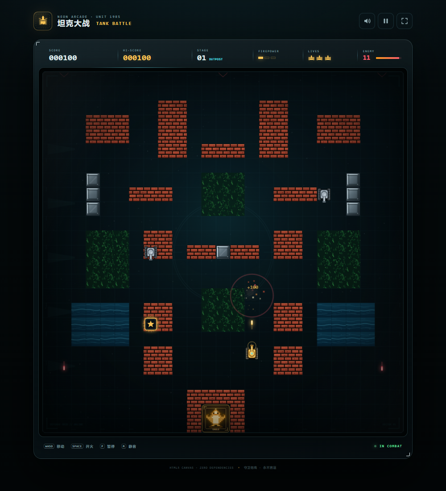
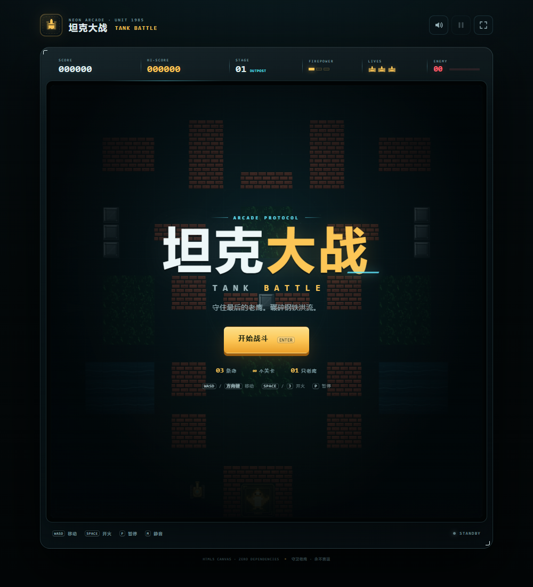

# 坦克大战 · TANK BATTLE

一款霓虹街机风格的 HTML5 坦克大战。纯 Canvas + 原生 JavaScript 实现，无框架、无构建步骤、无外部素材。

守护基地老鹰，迎击一波又一波敌军。摧毁砖墙、利用草丛、收集补给，在越来越凶猛的攻势中活下去。

<p align="center">
  <a href="https://rtlumina.github.io/tank-battle/"><strong>▶ 在线试玩</strong></a>
  &nbsp;·&nbsp;
  <a href="#操作">操作说明</a>
  &nbsp;·&nbsp;
  <a href="#本地运行">本地运行</a>
</p>



## 玩法

- 你驾驶金色战车，基地在屏幕下方中央。
- 消灭每关的全部敌军即可过关；基地被摧毁或生命耗尽则游戏结束。
- 敌军会主动寻路进攻基地，也会瞄准你的战车。
- 每关有 3 辆闪烁的补给运输坦克，击毁后会掉落随机强化道具。
- 清空全部敌军后进入下一关。三张手工地图循环使用，难度持续上升，关卡无尽。

## 特性

- **经典街机内核**：可破坏砖墙、不可破坏钢墙、水体阻挡、草丛隐蔽、双方炮弹互相抵消。
- **四种敌军**：轻型、高速、火力、重甲。敌军使用加权寻路场向基地推进，同时会追踪玩家。
- **六种补给**：火力升级、能量护盾、全屏爆破、备用战车、基地加固、时间冻结。
- **三套地图主题**：前哨站、熔炉、丛林，循环推进并逐步增加敌军数量与强度。
- **原生音效**：全部使用 Web Audio API 实时合成，不依赖音频文件。
- **桌面与移动端**：键盘操作，移动端自动显示方向键与开火键。
- **街机机台界面**：扫描线、CRT 暗角、动态 HUD、关卡过场、本地最高分记录。
- **零依赖**：无需 npm，无第三方字体、图片、音频或运行时库。

## 操作

| 操作 | 键盘 | 触屏 |
| --- | --- | --- |
| 移动 | `W` `A` `S` `D` / 方向键 | 左侧方向键 |
| 开火 | `空格` / `J` | 右侧 FIRE 按钮 |
| 暂停 / 继续 | `P` / `Esc` | 右上角暂停按钮 |
| 静音 / 恢复 | `M` | 右上角音量按钮 |
| 开始 / 继续 / 重开 | `Enter` | 屏幕按钮 |

> 开火键可以按住连续射击，实际射速由火力等级决定。

## 本地运行

项目完全静态，克隆后用任意静态文件服务器打开即可，不要直接双击 `index.html`（避免个别浏览器限制本地资源）。

```bash
git clone https://github.com/RtLumina/tank-battle.git
cd tank-battle

# 任选其一
python3 -m http.server 8080
# 或
npx serve .
```

打开 <http://localhost:8080>。

## 项目结构

```text
tank-battle/
├── index.html              # 页面骨架、HUD、覆盖层与触屏控件
├── css/
│   └── style.css           # 街机机台视觉、响应式与动效
├── js/
│   └── game.js             # 游戏引擎、AI、物理、渲染与音效
├── assets/
│   ├── favicon.svg
│   ├── screenshot-title.png
│   └── screenshot-gameplay.png
├── README.md
└── .gitignore
```

## 技术实现

- **Canvas 2D**：固定 800 × 800 逻辑战场，25 × 25 网格，按设备像素比渲染；全部画面均为代码绘制。
- **游戏循环**：`requestAnimationFrame` + 帧时间裁剪，避免切后台或卡顿造成穿模。
- **敌军寻路**：以基地为目标执行加权 Dijkstra 流场计算；砖墙可打通但代价更高，钢墙与水体视为障碍。地图被破坏或加固后自动重算。
- **碰撞**：基于轴对齐包围盒 + 分步子弹检测；转向时自动对齐车道，保证狭窄通道可通行。
- **音效**：振荡器、噪声缓冲与滤波组合出不同音色，首次交互后才初始化 `AudioContext`。
- **持久化**：最高分与静音偏好存入 `localStorage`。

开发调试：访问 `?debug=1` 后，可在控制台通过 `window.__tankBattle.getSnapshot()` 查看游戏状态。

## 兼容性

建议使用最新版 Chrome、Edge、Firefox 或 Safari。需要支持 Canvas 2D、Web Audio、CSS Container Queries 与 `color-mix()`。

## 画面预览

| 标题界面 | 游戏画面 |
| --- | --- |
|  |  |

---

所有地图、像素图形与音效均在运行时由代码生成；不包含第三方美术或音频素材。
